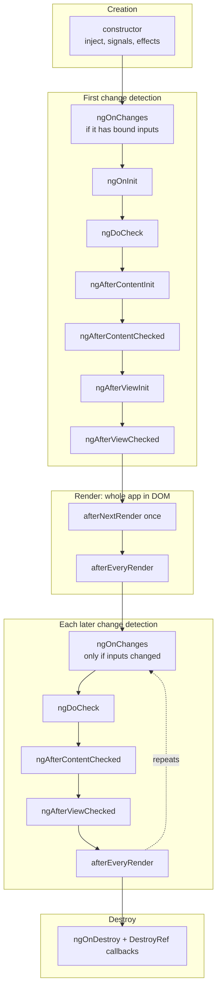
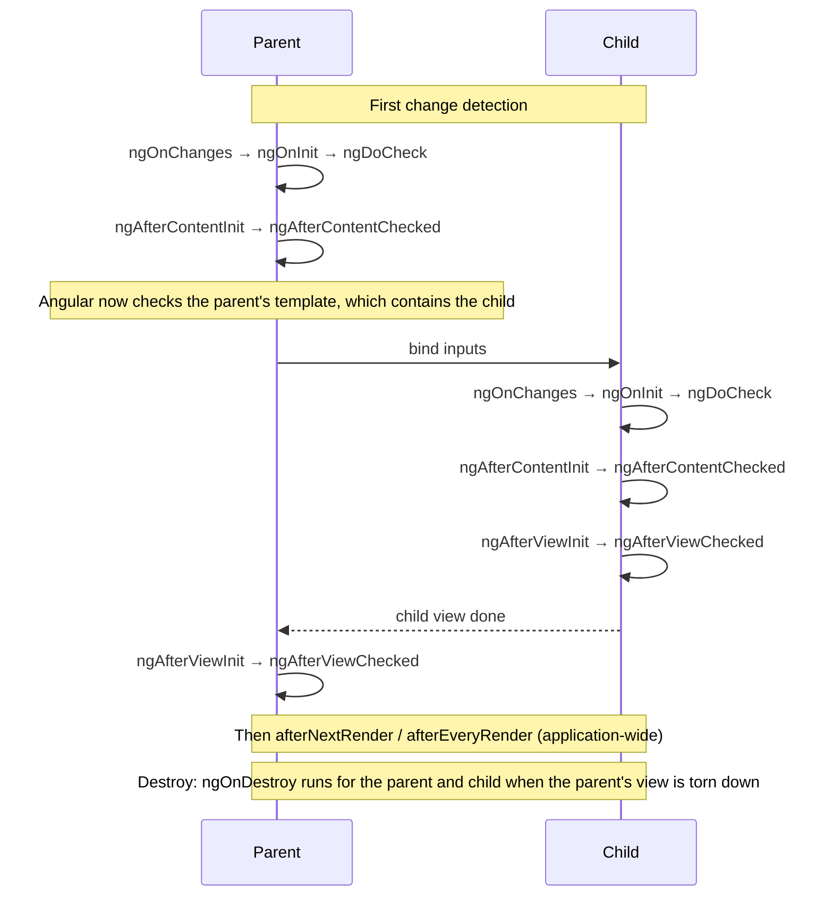

# 🔁 Lifecycle cheat sheet (Angular 22)

A one-page summary. Deep dive: [03 · Lifecycle](../03-lifecycle/theory.md).
Main source: [Component Lifecycle guide](https://angular.dev/guide/components/lifecycle).

## 1. Component & directive hooks, in order

| # | Hook | When | How often | Typical use | What is available |
|---|---|---|---|---|---|
| 0 | `constructor` *(not a hook)* | Angular instantiates the class | once | `inject()`, create signals / `computed` / `effect`, `DestroyRef.onDestroy`, `afterNextRender` registration | DI only. **Inputs are not set yet**, and there is no DOM or children. |
| 1 | `ngOnChanges(changes)` | before `ngOnInit`, then whenever a **bound input** changes (template binding or `setInput`) | 0..n (never if there are no bound inputs) | react to input changes with `SimpleChanges` (`previousValue`, `currentValue`, `firstChange`) | the new input values. Also fires for signal inputs, but prefer `computed`/`effect` there. |
| 2 | `ngOnInit` | after the first `ngOnChanges` | **once** | initialization that needs the initial inputs | inputs ✅, view children ❌, content children ❌ |
| 3 | `ngDoCheck` | on every change detection pass that reaches this component, right after `ngOnChanges`/`ngOnInit` | very often | custom change detection (rare) | runs **even if an OnPush component is then skipped** ([DoCheck API](https://angular.dev/api/core/DoCheck)) |
| 4 | `ngAfterContentInit` | after the projected content (`<ng-content>`) is initialized | **once** | read `@ContentChild` / `contentChild()` results | content queries ✅ |
| 5 | `ngAfterContentChecked` | after each check of the projected content | very often | rarely needed | content queries ✅ |
| 6 | `ngAfterViewInit` | after the component's own view **and its children's views** are initialized | **once** | read `@ViewChild` / `viewChild()` results, start a third-party lib (but prefer `afterNextRender`) | view queries ✅, child components ✅ |
| 7 | `ngAfterViewChecked` | after each check of the view | very often | rarely needed | view queries ✅ |
| 8 | `ngOnDestroy` | just before the instance is destroyed (`@if` false, navigation away, `ComponentRef.destroy()`) | **once** | cleanup: unsubscribe, clear timers, detach listeners | everything is still there |

Lifecycle interfaces (`OnInit`, `OnChanges`, …) are optional and only help catch typos.
When directives share an element with a component, **their hook order relative to each other is not guaranteed**.

## 2. Render hooks (application-wide, function-based)

| API | Runs | Notes |
|---|---|---|
| `afterNextRender(cb \| phases)` | **once**, the next time the whole app has rendered to the DOM | Good place for one-time DOM setup (measure, init a chart). |
| `afterEveryRender(cb \| phases)` | after **every** render of the app | Was called `afterRender` before v20. Keep it cheap. |
| `afterRenderEffect(phases)` | after render, **only when the signals it reads change** | Combines `effect` with render phases. |

- Call them in an **injection context** (typically the constructor). They return an `AfterRenderRef` with `destroy()`, and they are cleaned up automatically with the component.
- They **do not run on the server** (SSR / prerender), so they are the safe place for browser-only DOM code.
- **Phases**, run in this order: `earlyRead` → `write` → `mixedReadWrite` (the default if you pass a single callback) → `read`. A phase can return a value that the next phase receives.

```ts
constructor() {
  afterNextRender({
    write: () => { this.el.nativeElement.style.padding = '8px'; return true; },
    read: (didWrite) => { if (didWrite) this.height = this.el.nativeElement.offsetHeight; },
  });
}
```

Sources: [afterNextRender](https://angular.dev/api/core/afterNextRender) · [afterEveryRender](https://angular.dev/api/core/afterEveryRender) · [afterRenderEffect](https://angular.dev/api/core/afterRenderEffect)

## 3. `DestroyRef`: the modern alternative to `ngOnDestroy`

```ts
private destroyRef = inject(DestroyRef);
constructor() {
  const id = setInterval(() => this.tick(), 1000);
  this.destroyRef.onDestroy(() => clearInterval(id)); // returns an "unregister" function
}
```

- In a component or directive, callbacks run when **that component or directive** is destroyed. Anywhere else, they run when the **injector** that owns it is destroyed ([DestroyRef API](https://angular.dev/api/core/DestroyRef)).
- `destroyRef.destroyed` is `true` once it has been destroyed. Check it in async code to avoid NG0911.
- `takeUntilDestroyed()` (from `@angular/core/rxjs-interop`) uses `DestroyRef` to complete an Observable: `obs$.pipe(takeUntilDestroyed())` in an injection context, or `takeUntilDestroyed(this.destroyRef)` elsewhere ([docs](https://angular.dev/ecosystem/rxjs-interop/take-until-destroyed)).

## 4. Which hooks apply to what?

| Kind of class | Hooks it gets |
|---|---|
| Component | all of section 1, plus the render hooks if you register them |
| Directive | all of section 1 (a directive has no own view, but `ngAfterViewInit` still runs) |
| **Service** (`@Injectable` / `@Service`) | **only `ngOnDestroy`**, called when its **injector** is destroyed. No `ngOnInit`, no `ngOnChanges`. The constructor runs lazily at the first injection. |
| **Pipe** | **only `ngOnDestroy`**, e.g. `AsyncPipe` unsubscribes in it |

The `OnDestroy` API says the hook runs *"before a directive, pipe, or service instance is destroyed"* ([OnDestroy](https://angular.dev/api/core/OnDestroy)).
A root service is destroyed only when the app is destroyed (`ApplicationRef.destroy()`).
A service in a component's `providers` is destroyed **with that component**.

## 5. Order diagrams

### One component: first render → updates → destroy



### Parent with a child: who goes first?



Rule of thumb: **"Init / DoCheck / Content" hooks go top-down (parent first). "View" hooks go bottom-up (children first)**,
because the parent's view is only "initialized" once all its children are.

> ⚠️ Not stated in the official docs: the exact order of the **constructors** across parent and child, and the order of `ngOnDestroy` between parent and children.
> They are implementation details, so don't rely on them.

## 6. Common mistakes

| Mistake | Why it's wrong | Fix |
|---|---|---|
| Reading an input in the `constructor` | Inputs aren't set yet (undefined, or `input.required` throws NG0950) | Use `ngOnInit`, or better a `computed` |
| Using `viewChild` results in `ngOnInit` | The view isn't created yet | Use `ngAfterViewInit`, a `computed`/`effect`, or `afterNextRender` |
| Changing parent-bound state in `ngAfterViewInit` | `ExpressionChangedAfterItHasBeenCheckedError` (NG0100) | Derive the value earlier, or use signals |
| Heavy work in `ngDoCheck` / `ngAfter*Checked` | They run on every change detection pass | Remove them; use signals / `computed` |
| Expecting `ngOnChanges` when mutating an object input | Only a **new reference** counts | Use immutable updates |
| Expecting `ngOnChanges` after `child.someInput = x` from TypeScript | Only template bindings and `ComponentRef.setInput` trigger it | Use `setInput`, or a signal/`model` |
| Using `window`/`document` in `ngOnInit` with SSR | It runs on the server too | Use `afterNextRender` |
| Adding `ngOnInit` to a service | Services never get it; it silently never runs | Use the constructor (it runs at first injection) or `provideAppInitializer` |
| Forgetting to unsubscribe | Leaks after destroy | Use `takeUntilDestroyed()`, `toSignal`, or the `async` pipe |
| Calling `inject()` / `afterNextRender` / `takeUntilDestroyed()` with no argument inside `ngOnInit` | Not an injection context → NG0203 | Call them in the constructor or a field initializer, or pass `injector` / `DestroyRef` explicitly |

## 📚 References

- https://angular.dev/guide/components/lifecycle
- https://angular.dev/api/core/OnChanges
- https://angular.dev/api/core/DoCheck
- https://angular.dev/api/core/OnDestroy
- https://angular.dev/api/core/DestroyRef
- https://angular.dev/api/core/afterNextRender
- https://angular.dev/api/core/afterEveryRender
- https://angular.dev/api/core/afterRenderEffect
- https://angular.dev/ecosystem/rxjs-interop/take-until-destroyed
- https://angular.dev/api/core/ComponentRef
- https://angular.dev/errors/NG0100
- https://angular.dev/errors/NG0203
- https://angular.dev/api/core/ApplicationRef
